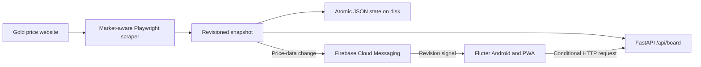

# Aurum Thai API

Backend API and price scraper for Thai Gold View. The service retrieves Gold Traders Association data during market hours, maintains one revisioned public snapshot, and sends Firebase Cloud Messaging (FCM) events for real price-data changes.

**[Live Application](https://thaigoldview.com) · [Live API Sample](https://api.thaigoldview.com/api/board) · [Health Check](https://api.thaigoldview.com/health) · [Flutter Repository](https://github.com/iceswift/tgw_app)**

## Project overview

This repository contains the data collection, snapshot persistence, HTTP API, and notification components of Thai Gold View. It demonstrates an end-to-end service deployed with Docker on an Ubuntu home server and exposed through Cloudflare Tunnel.

## Engineering highlights

- **Asynchronous collection:** Playwright retrieves source data while FastAPI serves cached snapshots.
- **Market-aware scheduling:** randomized polling intervals vary with market windows, recent changes, unchanged results, and failures. Browser resources are released between cycles.
- **Persistent revisions:** canonical JSON comparison identifies snapshot changes, and temporary-file replacement persists revision and snapshot together.
- **Conditional responses:** `/api/board` supports ETags and bodyless `304` responses to reduce repeat transfers.
- **Notification semantics:** data changes produce an FCM revision signal; market-status-only transitions are persisted silently.
- **Operational controls:** liveness/readiness endpoints, persistent data mounts, a container memory limit, and separate API and Web containers support production operation.

## System architecture



## Try the API

```bash
curl https://api.thaigoldview.com/api/board
```

The response includes the latest price, recent history, jewelry data, revision, update time, and freshness metadata. The live sample is useful for inspecting the response format without running the scraper locally.

## Scope and limitations

This is a periodically scraped data service, not a streaming market feed. The current schedule uses weekday and Saturday time windows in UTC+7; it does not include a separate public-holiday calendar. Shop scraping is currently disabled in production. Availability depends on the source website, home server, and Internet connection.

## Code guide

| File | Responsibility |
| --- | --- |
| [`main.py`](main.py) | FastAPI routes, scheduler, browser lifecycle, and Firebase integration. |
| [`snapshot_state.py`](snapshot_state.py) | Snapshot construction, canonical comparison, revision persistence, and file locking. |
| [`shop.py`](shop.py) | Shop scraper implementations; currently disabled in production. |
| [`docker-compose.yml`](docker-compose.yml) | API container, persistent mounts, memory limit, and health check. |

## Production architecture

### Kubernetes migration case study

The live API runs on a single-node K3s home server behind Cloudflare Tunnel.
FastAPI serves snapshots from PostgreSQL, while one separate scheduler
scrapes during market hours and publishes price updates through Firebase.
Docker Compose is retained for rollback. Argo CD, HPA, and the monitoring
stack were verified in staging, not deployed as production dependencies.

| Area | Verified result |
| --- | --- |
| Runtime split | A CronJob-derived worker wrote to PostgreSQL; two API instances agreed on revisions and ETags. |
| GitOps | Argo CD deployed a GHCR image by digest and restored the prior image after a Git revert. |
| Operations | Staging HTTPS passed certificate verification, and CPU load scaled the API from one to three ready pods. |
| Monitoring | Prometheus scraped API and worker metrics, and Grafana queried both. A live worker run peaked at 583 MiB for the full container. |
| Production cutover | Eight public read endpoints and conditional HTTP 304 passed. The first live market session advanced the board from revision 1035 to 1055, and Firebase accepted topic publications. |

See the [readiness runbook](deploy/kubernetes/PRODUCTION_READINESS.md) and
[migration roadmap](https://github.com/iceswift/aurum-thai/issues/9) for
the verification evidence and rollback procedure.

See the [Kubernetes staging and migration guide](deploy/kubernetes/README.md)
for the separate Kubernetes baseline and GitOps roadmap.

```text
/srv/thai-gold-view/
  k3s-production/postgres/  # Production PostgreSQL local volume
  k3s-staging/postgres/     # Separate staging data
  app/                     # Retained Compose definition
  data/                    # Legacy Compose snapshot and notification state
  secrets/                 # Host credentials; never commit
  web/                     # Separate PWA releases and Nginx configuration
  backups/                 # Deployment and cutover backups
```

Cloudflare Tunnel publishes the production Kubernetes Service at
`https://api.thaigoldview.com`. The PWA runs separately.

## API

| Endpoint | Purpose |
| --- | --- |
| `GET /health` | Process liveness and Firebase/CORS diagnostics. |
| `GET /ready` | Readiness, data age, staleness, and market status. |
| `GET /api/board` | One consistent revisioned snapshot for the app. |
| `GET /api/latest`, `/api/history`, `/api/gold` | Current and historical gold data. |
| `GET /api/percent_jewelry`, `/api/shops` | Jewelry and shop data. |
| `POST /api/push/subscribe` | Subscribes a Web FCM token to the fixed topic. |

### Board snapshots and ETags

`/api/board` returns one logical snapshot with `revision`, ISO-8601 `updated_at`, `market_status`, `latest`, `history`, `jewelry`, and `shops`. It sets `ETag: W/"gold-board-<revision>"`; clients can send `If-None-Match` and receive `304 Not Modified`.

Snapshot state is atomically persisted in `/srv/thai-gold-view/data`, so a container restart does not reset its revision.

## FCM behavior

The topic is `gold_price_updates`. A price-data snapshot change sends a data-only payload:

```json
{
  "type": "gold_snapshot_updated",
  "revision": "541",
  "updated_at": "2026-10-17T10:05:00+07:00",
  "user_visible": "true"
}
```

The Flutter client fetches `/api/board` as the source of truth. A market-status-only change, including the change at midnight when the day changes, is persisted but does not send FCM. This prevents spurious price notifications.

## Configuration

Copy `.env.example` to `.env` on the server:

```dotenv
APP_HOST=0.0.0.0
APP_PORT=8000
CORS_ALLOWED_ORIGINS=https://thaigoldview.com,https://www.thaigoldview.com
FIREBASE_CREDENTIALS_PATH=/run/secrets/firebase-service-account.json
NOTIFICATION_STATE_FILE=/app/data/notification_state.json
SNAPSHOT_STATE_FILE=/app/data/gold_snapshot_state.json
FCM_TOPIC_NAME=gold_price_updates
STALE_AFTER_MINUTES=10
```

`firebase-service-account.json` belongs in `/srv/thai-gold-view/secrets/` with restricted permissions. Never commit it.

## Local development

```bash
git clone https://github.com/iceswift/aurum-thai.git
cd aurum-thai
python -m venv .venv
source .venv/bin/activate
pip install -r requirements.txt
playwright install chromium
python main.py
```

For Docker development, create `.env`, then run `docker compose up --build`.

## Home server deployment

From the home server, verify the production workloads:

```bash
export KUBECONFIG="$HOME/.kube/aurum-k3s.yaml"
kubectl -n aurum-production get deployments,services,pvc
kubectl -n aurum-production logs deployment/aurum-scheduler --tail=50
curl -fsS https://api.thaigoldview.com/ready
```

For releases, keep the production Service and its ClusterIP in place.
Validate the image in staging first and verify readiness after rollout.
The worker manifest starts at zero replicas for initial provisioning;
do not reapply it to a running scheduler without planning that pause.

## Rollback

Follow the [production rollback runbook](deploy/kubernetes/PRODUCTION_READINESS.md#home-server-cutover-2026-11-14)
before restarting Compose. Stop the K3s scheduler and preserve the latest
PostgreSQL revision so the two scrapers never run at the same time.
